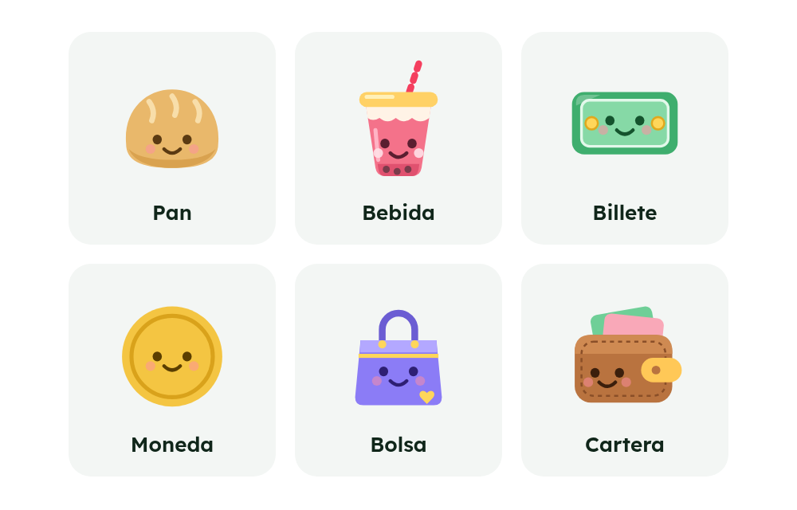

# Vento

**Español** · [English](#english)



Libreta de compraventa para Android. Anotas quién te pidió qué, si ya pagó (y con qué medio), si ya le entregaste el pedido, y la app te dice cuánto ganas por producto y por pedido. Tus datos viven solo en tu teléfono: no hay servidor ni cuentas.

## Qué hace

- **Pedidos paso a paso:** cliente, productos, pago y entrega, con un resumen final antes de guardar. Pagos por partes (abonos) y varios productos por pedido.
- **Pedido cerrado:** cuando está pagado y entregado ya no se puede editar (se reabre desmarcando la entrega).
- **Historial:** los pedidos ya entregados y pagados salen de Pendientes y quedan aparte, agrupados por día como los movimientos de un banco. Puedes cambiar la fecha de cualquier pedido.
- **Buscador** en pedidos, clientes y productos (sin importar mayúsculas ni tildes).
- **Clientes:** historial, teléfono opcional y filtro de quién te debe.
- **Productos:** costo y precio de venta, con categorías y filtro por categoría.
- **Inicio:** ganancia del mes (o total), cuánto llevas cobrado y cuánto te falta para llegar a lo vendido, lo que falta entregar y los productos que más te dejan.
- **Idioma:** español e inglés. Se elige en Más → Apariencia e idioma, o sigue el idioma del teléfono.
- **Personalización:** color de la app (6 a elegir), modo claro, oscuro o automático, y una mascota (pan, bebida, billete, moneda, bolsa o cartera) que te da las noticias: te saluda en Inicio, te dice quién te debe, firma el recordatorio, te acompaña con frases mientras anotas y sonríe cuando guardas algo.
- **Recordatorio diario** (opcional): una notificación a la hora que elijas con quién te debe y cuántos pedidos faltan. El detalle queda oculto en la pantalla bloqueada.
- **Copias de seguridad:** se guardan en una carpeta llamada `vento` que tú eliges, a mano o de forma automática (cada día, semana o mes). La copia guarda también tu estilo (color, modo, mascota e idioma) y lo devuelve al restaurar. También puedes restaurar una copia, enviarla a otra app o exportar tus ventas a Excel / Google Sheets (CSV).

## Descargar

El APK de cada versión está en [Releases](../../releases). Descárgalo en el teléfono, ábrelo y acepta instalar apps de fuentes desconocidas (es un APK propio, no viene de Google Play).

## Permisos y privacidad

Tus datos nunca salen del teléfono: no hay servidor ni cuentas. La app usa internet para **una sola cosa**: preguntarle a GitHub si hay una versión nueva (una vez al día; se apaga en Más → Versión) y no le envía nada tuyo. Además pide lo necesario para el recordatorio (notificaciones, vibrar y volver a programar los avisos al reiniciar el teléfono). Las copias de seguridad van a la carpeta que tú eliges con el selector del sistema.

## Cómo correrla

Necesitas Node.js y un teléfono Android con [Expo Go](https://expo.dev/go) o un emulador.

```sh
npm install
npx expo start
```

Escanea el código QR con Expo Go. Si algo no se actualiza, `npx expo start --clear`.

Nota: en Expo Go de Android no se puede crear el canal de notificaciones, así que el recordatorio usa el canal por defecto del sistema y no oculta el detalle en la pantalla bloqueada. Eso solo funciona en una versión instalada (APK).

### Pruebas y revisión

```sh
node --test src/        # pruebas (el dinero, las copias y el SQL corren sobre SQLite real)
npx tsc --noEmit        # tipos
npx expo lint           # lint
```

### Instalarla como APK

- **En tu equipo** (JDK 17 o más y el SDK de Android; usa `~/Android/Sdk` o lo que pongas en `ANDROID_HOME`): `npm run apk` deja el archivo en `dist/vento-<versión>.apk`, firmado con **tu propia llave** (se crea una vez con `npm run llave`; se guarda en `~/.vento` y nunca se sube al repositorio). Quien compile su propia copia necesita su propia llave.
- **En la nube**: [EAS Build](https://docs.expo.dev/build/setup/) (`npx eas-cli build -p android --profile preview`, necesita una cuenta de Expo gratis). EAS guarda tu llave de firma por ti.

Las imágenes de las mascotas de este README salen de `npm run preview`.

## Cómo está hecha

Expo + React Native + Expo Router, TypeScript y SQLite local (`expo-sqlite`). El dinero son pesos enteros (sin decimales). La lógica de dinero, copias y avisos está en módulos puros (`src/calc.ts`, `src/respaldo.ts`, `src/aviso-calc.ts`, `src/formato.ts`) para poder probarla sin teléfono. Los textos están en español e inglés (`src/idioma.ts`; una prueba falla si falta alguna traducción). Hay más detalles para quien quiera contribuir en [`CLAUDE.md`](CLAUDE.md).

## Licencias de terceros

Expo y React Native: MIT · Phosphor Icons: MIT · Fuentes Lexend y Unbounded: SIL Open Font License 1.1.

## Licencia

Copyright (C) 2026 Vento contributors. Este programa es software libre: puedes redistribuirlo y modificarlo bajo los términos de la [GNU General Public License v3.0](LICENSE). Se distribuye sin ninguna garantía.

---

## English

### Download

The APK for each version is in [Releases](../../releases). Download it on your phone, open it and allow installing apps from unknown sources (it is our own APK, not from Google Play).

A sales notebook for Android. You write down who ordered what, whether they have paid (and how), whether you have delivered it, and the app tells you your profit per product and per order. Your data lives only on your phone: no server, no accounts.

### Features

- **Step-by-step orders:** client, products, payment and delivery, with a final summary before saving. Partial payments and several products per order.
- **Closed orders:** once an order is paid and delivered it can't be edited (un-mark the delivery to reopen it).
- **History:** orders that are delivered and paid leave Pending and live apart, grouped by day like a bank's movements. You can change any order's date.
- **Search** in orders, clients and products (ignoring case and accents).
- **Clients:** history, optional phone number, and a "who owes me" filter.
- **Products:** cost and sale price, with categories and a filter per category.
- **Home:** profit for the month (or all time), what you are owed, what is left to deliver, and your most profitable products.
- **Language:** Spanish and English. Pick it in More → Appearance and language, or let it follow your phone.
- **Personalization:** pick the app colour (6 to choose from), light, dark or automatic mode, and a mascot (bread, drink, banknote, coin, bag or wallet) that gives you the news: it greets you on Home, tells you who owes you, signs the reminder, walks you through forms with short lines and smiles when you save something.
- **Daily reminder** (optional): a notification at the time you choose listing who owes you and how many orders are left to deliver. The details stay hidden on the lock screen.
- **Backups:** saved in a folder called `vento` that you pick, by hand or automatically (daily, weekly or monthly). A backup also keeps your style (colour, mode, mascot and language) and brings it back on restore. You can also restore a backup, send it to another app, or export your sales to Excel / Google Sheets (CSV).

### Permissions and privacy

Your data never leaves the phone: no server, no accounts. The app uses the internet for **one thing only**: asking GitHub whether there is a new version (once a day; turn it off in More → Version), and it sends nothing of yours. It also asks for what the reminder needs (notifications, vibration and rescheduling the alerts after a reboot). Backups go to the folder you pick with the system picker.

### Run it

You need Node.js and an Android phone with [Expo Go](https://expo.dev/go), or an emulator.

```sh
npm install
npx expo start
```

Scan the QR code with Expo Go. If something doesn't update, run `npx expo start --clear`.

Note: Expo Go on Android can't create the notification channel, so the reminder uses the system's default channel and does not hide its details on the lock screen. That only works in an installed build (APK).

### Tests and checks

```sh
node --test src/        # tests (money, backups and SQL run against a real SQLite)
npx tsc --noEmit        # types
npx expo lint           # lint
```

### Install as an APK

- **On your machine** (JDK 17+ and the Android SDK; it uses `~/Android/Sdk` or whatever `ANDROID_HOME` points to): `npm run apk` leaves the file in `dist/vento-<version>.apk`, signed with **your own key** (create it once with `npm run llave`; it lives in `~/.vento` and is never committed). Anyone building their own copy needs their own key.
- **In the cloud**: [EAS Build](https://docs.expo.dev/build/setup/) (`npx eas-cli build -p android --profile preview`, needs a free Expo account). EAS keeps your signing key for you.

The mascot pictures in this README come from `npm run preview`.

### How it is built

Expo + React Native + Expo Router, TypeScript and local SQLite (`expo-sqlite`). Money is whole pesos (no decimals). The money, backup and reminder logic lives in pure modules (`src/calc.ts`, `src/respaldo.ts`, `src/aviso-calc.ts`, `src/formato.ts`) so it can be tested without a phone. The texts are in Spanish and English (`src/idioma.ts`; a test fails if a translation is missing). More notes for contributors are in [`CLAUDE.md`](CLAUDE.md).

### Third-party licenses

Expo and React Native: MIT · Phosphor Icons: MIT · Lexend and Unbounded fonts: SIL Open Font License 1.1.

### License

Copyright (C) 2026 Vento contributors. This program is free software: you can redistribute it and/or modify it under the terms of the [GNU General Public License v3.0](LICENSE). It comes with no warranty.
